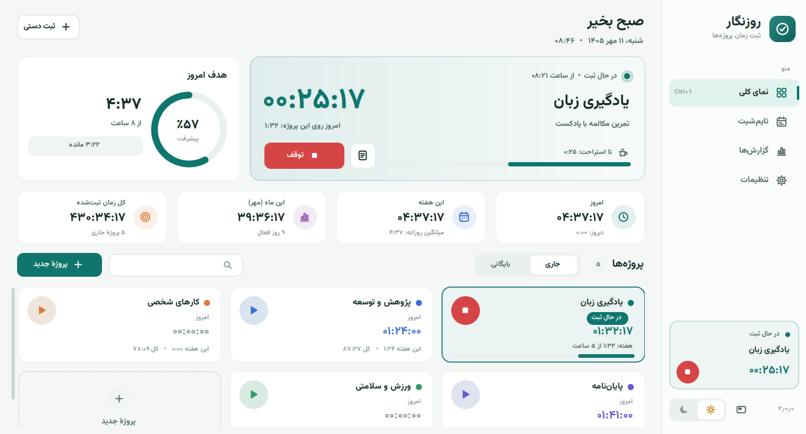
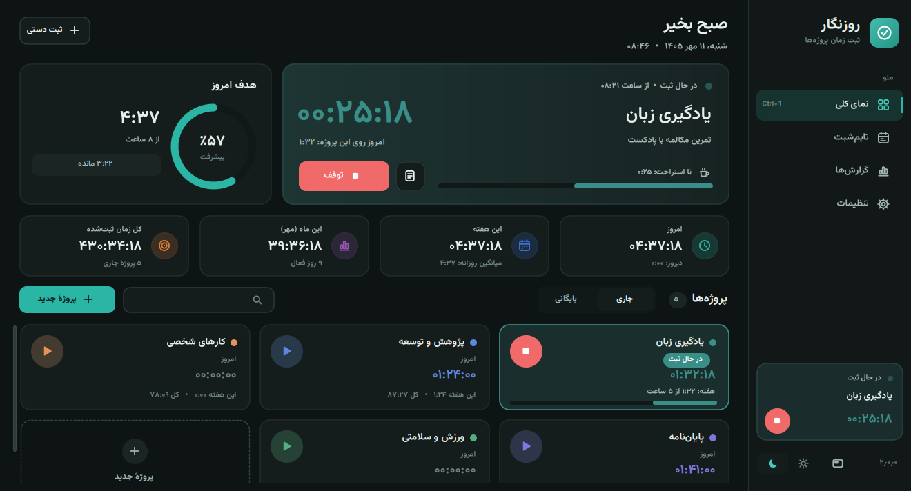
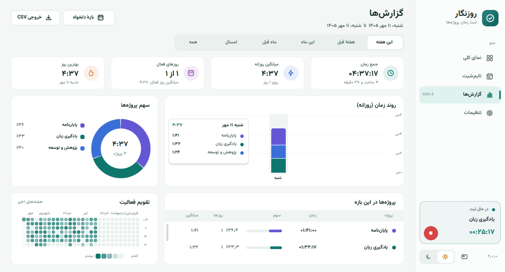
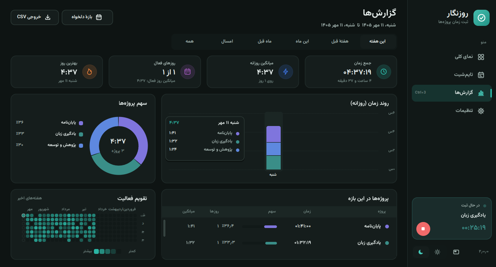
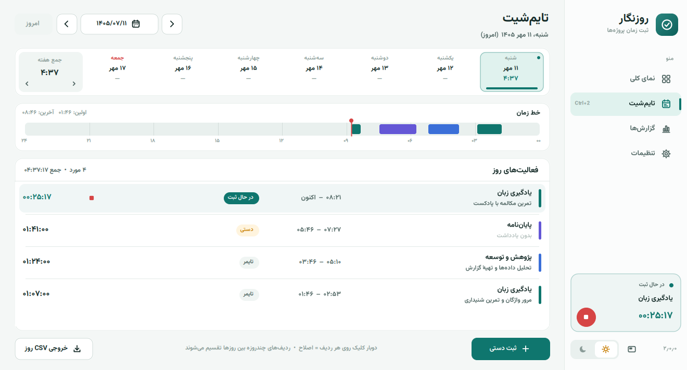
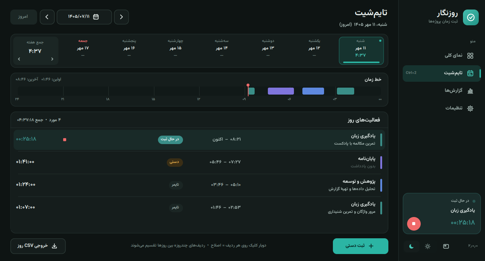

# Rooznegar

**A standalone Windows time tracker with a Persian (RTL) interface and the Jalali (Solar Hijri) calendar.**

Built in C# on .NET Framework with WinForms, with every control custom-drawn: cards, vector icons, hover states, tooltips, charts and a Jalali date picker. It ships as a single `.exe` with the Vazirmatn font embedded.

[فارسی](README.fa.md)

| Light theme | Dark theme |
|---|---|
|  |  |
|  |  |
|  |  |

## Features

- **Dashboard:** a large timer card with notes, quick-start buttons for recent projects, a daily-goal progress ring, a streak counter, and totals for today, this week, this month and all time.
- **Projects:** start and stop from each project card, see today's time, set an optional weekly goal with a progress bar, search inline, and archive or delete projects. Deleting first shows what will be removed and can be undone for a few seconds.
- **Timesheet:** a week strip with daily totals, a 24-hour timeline, one-click "continue" for any activity, and delete with undo.
- **Reports:** stacked bar charts per project (daily, weekly or monthly), a donut chart of project share, an activity heatmap, the daily average, active days and the best day. Reports export to CSV.
- **Ideas borrowed from Toggl, Clockify, RescueTime and Forest:**
  - an always-on-top floating mini timer
  - a global hotkey <kbd>Ctrl+Alt+Space</kbd> to start or stop
  - idle detection with three choices: keep the time, discard it and continue, or discard it and stop
  - Pomodoro-style break reminders
  - resuming the last project from the tray, the sidebar or a hotkey
  - a tray icon that shows a dot in the active project's colour
  - Jalali date and range pickers
  - in-app toasts instead of message boxes
  - keyboard shortcuts <kbd>Ctrl+1..4</kbd>, <kbd>Ctrl+N</kbd>, <kbd>Ctrl+M</kbd>, <kbd>Ctrl+F</kbd> and <kbd>Ctrl+T</kbd>
- **Display:** light and dark themes that can follow the Windows setting (including a dark title bar), and proper DPI scaling at 125%, 150% and higher.

### Reliability

- Sessions can never overlap, and sessions that cross midnight are split per day.
- Sleep time counts as work by default; asking after sleep can be turned on in Settings.
- Saves are atomic, a daily backup is kept, and corrupt files are recovered from the last valid state.
- CSV export is protected against formula injection.
- Unexpected errors never close the app. They are logged to `%LOCALAPPDATA%\Rooznegar\errors.log` while the timer and data are kept, and a rendering error in one section only blanks that section.

## Tech stack

| | |
|---|---|
| Language | C# 5 |
| Runtime | .NET Framework 4.7.2+ (Windows 10 / 11) |
| UI | WinForms, fully custom-painted (GDI+) |
| Font | [Vazirmatn](https://github.com/rastikerdar/vazirmatn), embedded as a resource |
| Installer | NSIS 3, per-user install with no admin rights needed |
| Build | `csc.exe` from .NET Framework; no Visual Studio or NuGet needed |

## Project structure

| Path | Purpose |
|---|---|
| `src/Core.cs` | Data model, Jalali calendar, time engine, idle-time removal, project delete/undo, streaks, CSV, persistence and recovery |
| `src/Theme.cs` | Light/dark palettes, embedded font loading, drawing helpers, vector icons |
| `src/Controls.cs` | Custom surface base class (hover, tooltip, scrolling), buttons, text input, toasts |
| `src/Pages.cs` | Sidebar, dashboard, timesheet, reports, settings |
| `src/Dialogs.cs` | Dialogs: Jalali calendar, range picker, project editor, manual entry, idle prompt |
| `src/Mini.cs` | Floating mini timer |
| `src/App.cs` | Main window, tray icon, global hotkey, idle detection, break reminders |
| `src/Program.cs` | Entry point, single-instance lock, preview and test modes |
| `tests/Tests.cs` | Self-contained tests for time logic and persistence |
| `installer.nsi` | Installer and uninstaller |
| `build-windows.cmd` | Builds the app, runs the tests and builds the installer |
| `fonts/` | Vazirmatn font files and their OFL licence |
| `build/Guide-FA.html` | User guide (Persian) |

## Building

```cmd
build-windows.cmd
```

The script compiles with the C# compiler that ships with .NET Framework, embeds the fonts from `fonts/`, runs the tests, and builds the installer if NSIS 3 is on `PATH`. The app is written to `build/Rooznegar.exe` and the installer to `../deliverables/Rooznegar-Setup-2.0.0.exe`.

## Testing

- **Unit tests:** 50 tests cover the time engine (midnight splits, sleep, DST, Jalali leap years, overlaps), persistence and recovery, CSV, project delete and undo, and idle handling. All 50 pass; see [`test-results.txt`](test-results.txt).
- **UI smoke test:** `Rooznegar.exe --smoke` opens every page in both themes at three window sizes and sweeps the mouse over each one to render every hover state and tooltip. It also runs every report range, empty days, activity and project delete/undo, every dialog and the mini timer, and fails on any logged error; see [`ui-test-results.txt`](ui-test-results.txt). To confirm the test catches real failures, a deliberate bug was injected into chart rendering and the test failed as expected.

## Data

Data lives in `%LOCALAPPDATA%\Rooznegar\data.json`. Files from version 1 load without conversion.

## Notes

The screenshots were taken at 1366×768 with demo data, in a Linux preview where Persian letters are joined by a simple built-in shaper; on Windows the OS shapes the text. Installation on real Windows, the global hotkey, idle detection and hardware sleep were not tested in that environment. The app and installer are not code-signed.
