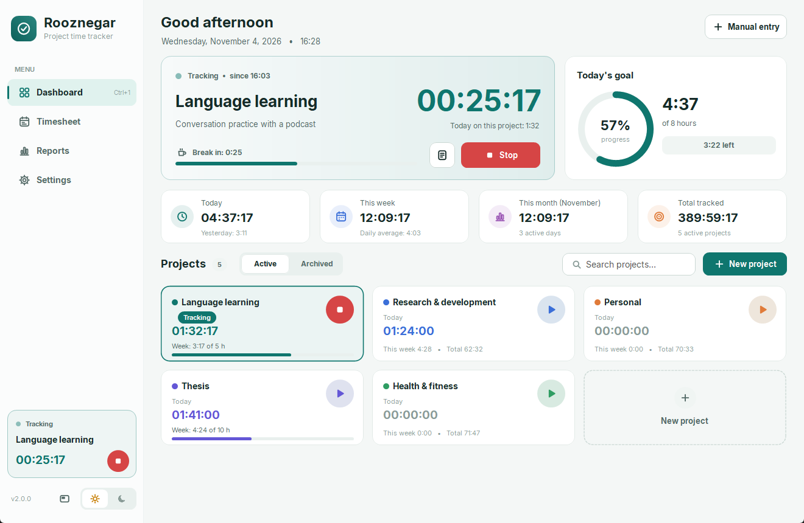
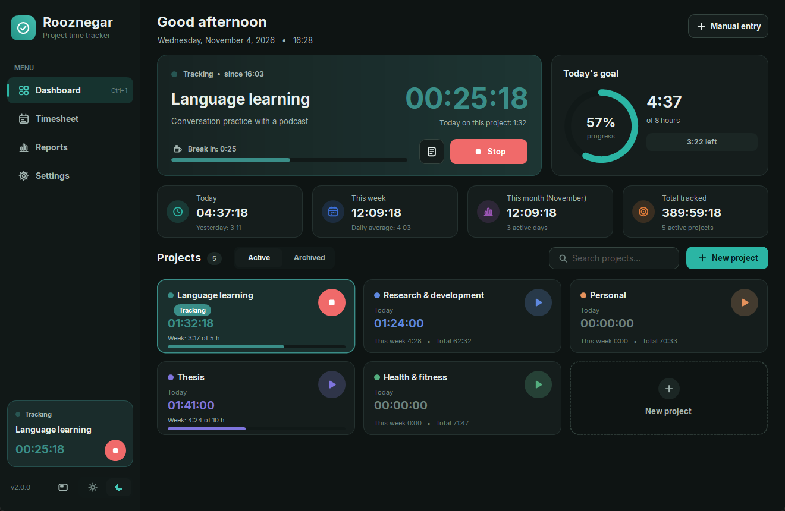
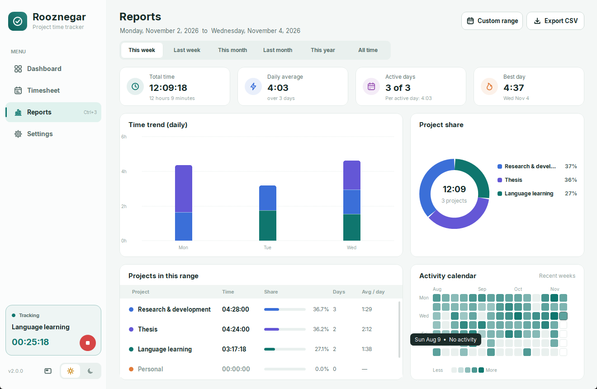
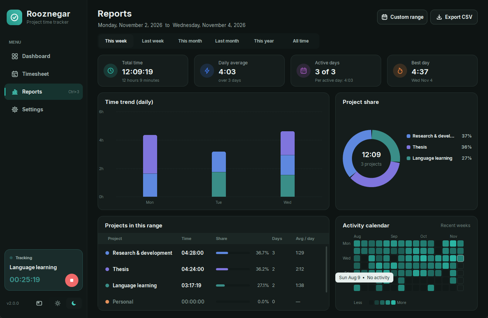
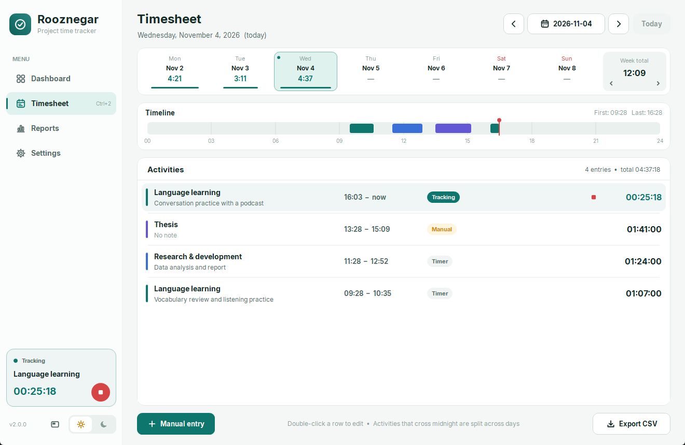
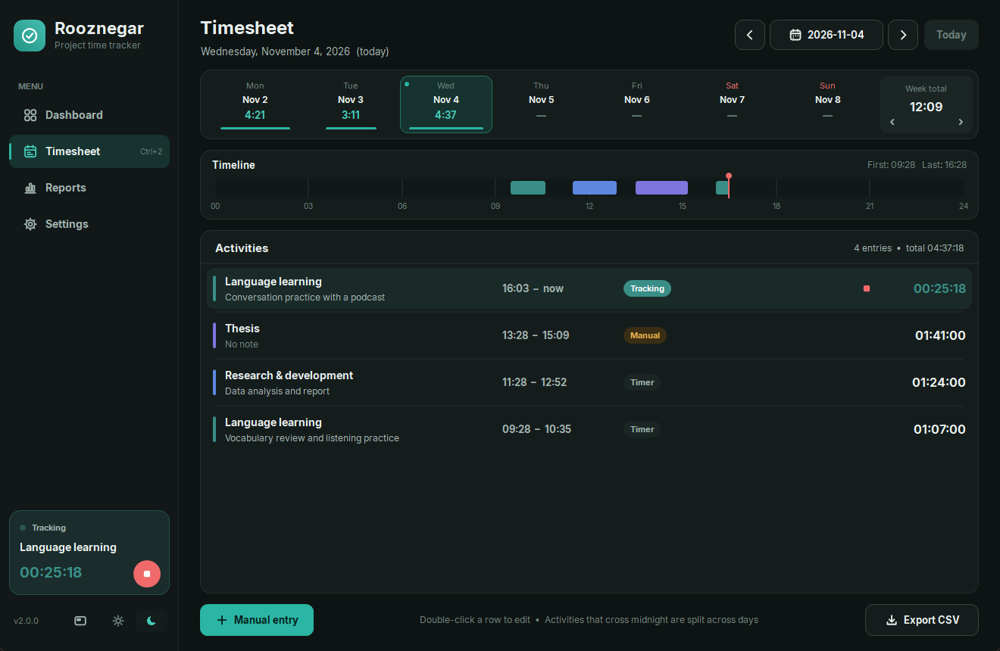

# Rooznegar

**A standalone project time tracker for Windows, built with C# and WinForms.**

Every control is custom-drawn, including cards, vector icons, hover states, tooltips, charts and the date picker, and the Inter font is embedded. The app ships as a single `.exe` with no dependencies beyond .NET Framework. *Rooznegar* means "daily journal" in Persian.

| Light theme | Dark theme |
|---|---|
|  |  |
|  |  |
|  |  |

## Features

- **Dashboard:** a large timer card with notes, quick-start buttons for recent projects, a daily-goal progress ring, a streak counter, and totals for today, this week, this month and all time.
- **Projects:** start and stop from each project card, see today's time, set an optional weekly goal with a progress bar, search inline, and archive or delete projects. Deleting first shows what will be removed and can be undone for a few seconds.
- **Timesheet:** a week strip with daily totals, a 24-hour timeline, one-click "continue" for any activity, and delete with undo.
- **Reports:** stacked bar charts per project (daily, weekly or monthly), a donut chart of project share, an activity heatmap, the daily average, active days and the best day. Reports export to CSV.
- **Ideas borrowed from Toggl, Clockify, RescueTime and Forest:**
  - an always-on-top floating mini timer
  - a global hotkey <kbd>Ctrl+Alt+Space</kbd> to start or stop
  - idle detection with three choices: keep the time, discard it and continue, or discard it and stop
  - Pomodoro-style break reminders
  - resuming the last project from the tray, the sidebar or the hotkey
  - a tray icon that shows a dot in the active project's color
  - calendar date and range pickers
  - in-app toasts instead of message boxes
  - keyboard shortcuts <kbd>Ctrl+1..4</kbd>, <kbd>Ctrl+N</kbd>, <kbd>Ctrl+M</kbd>, <kbd>Ctrl+F</kbd> and <kbd>Ctrl+T</kbd>
- **Display:** light and dark themes that can follow the Windows setting (including a dark title bar), and correct DPI scaling at 125%, 150% and higher.

### Reliability

- Sessions can never overlap, and sessions that cross midnight are split per day.
- Time is computed from UTC timestamps rather than timer ticks, so it survives sleep, restarts and DST changes.
- Saves are atomic, a daily backup is kept, and corrupt files are recovered from the last valid state.
- CSV export is protected against spreadsheet formula injection.
- Unexpected errors never close the app. They are logged to `%LOCALAPPDATA%\Rooznegar\errors.log` while the timer and data are kept, and a rendering error in one section only blanks that section.

## Tech stack

| | |
|---|---|
| Language | C# 5 |
| Runtime | .NET Framework 4.7.2+ (Windows 10 / 11) |
| UI | WinForms, fully custom-painted with GDI+ |
| Font | [Inter](https://github.com/rsms/inter), embedded as a resource |
| Installer | NSIS 3, per-user install with no admin rights needed |
| Build | `csc.exe` from .NET Framework; no Visual Studio or NuGet needed |

## How the UI is drawn

All pages derive from a small `Surface` control (`src/Controls.cs`) that handles painting, hit-testing, hover, tooltips and scrolling. Pages paint themselves each frame from an immutable `Snapshot` of the data and register clickable regions with `AddHit`.

The layout code is direction-agnostic. It measures from the reading-start edge, and `Ui.Mirror` (`src/Theme.cs`) flips each surface's coordinate system for left-to-right reading. Text and icons are drawn unmirrored at their mirrored positions, and mouse input is mapped back through `Surface.ToLogical`. A single flag, `Ui.Rtl`, switches the layout direction.

## Project structure

| Path | Purpose |
|---|---|
| `src/Core.cs` | Data model, dates, time engine, idle-time removal, project delete/undo, streaks, CSV, persistence and recovery |
| `src/Theme.cs` | Light/dark palettes, embedded font loading, layout mirroring, drawing helpers, vector icons |
| `src/Controls.cs` | Custom surface base class (hover, tooltip, scrolling), buttons, text input, toasts |
| `src/Pages.cs` | Sidebar, dashboard, timesheet, reports, settings |
| `src/Dialogs.cs` | Dialogs: calendar, range picker, project editor, manual entry, idle prompt |
| `src/Mini.cs` | Floating mini timer |
| `src/App.cs` | Main window, tray icon, global hotkey, idle detection, break reminders, screenshot and smoke-test modes |
| `src/Program.cs` | Entry point, single-instance lock, demo data |
| `tests/Tests.cs` | Self-contained tests for the time logic and persistence |
| `installer.nsi` | Installer and uninstaller |
| `build-windows.cmd` | Builds the app, runs the tests and builds the installer |
| `fonts/` | Inter font files and their OFL licence |
| `build/Guide.html` | User guide |

## Building

```cmd
build-windows.cmd
```

The script compiles with the C# compiler that ships with .NET Framework, embeds the fonts from `fonts/`, runs the tests, and builds the installer if NSIS 3 is on `PATH`. The app is written to `build/Rooznegar.exe` and the installer to `../deliverables/Rooznegar-Setup-2.0.0.exe`.

## Testing

- **Unit tests:** 50 tests cover the time engine (midnight splits, sleep, DST, leap days, overlaps), persistence and recovery, CSV, project delete and undo, and idle handling. All 50 pass; see [`test-results.txt`](test-results.txt).
- **UI smoke test:** `Rooznegar.exe --smoke` opens every page in both themes at three window sizes and sweeps the mouse over each one to render every hover state and tooltip. It also runs every report range, empty days, activity and project delete/undo, every dialog and the mini timer, and fails on any logged error; see [`ui-test-results.txt`](ui-test-results.txt).
- **Screenshots:** `Rooznegar.exe --preview <folder>` renders every page and dialog with demo data. The images above were made this way.

## Data

Data lives in `%LOCALAPPDATA%\Rooznegar\data.json` and never leaves the PC. Uninstalling does not delete it.

## Notes

The app and installer are not code-signed, so Windows SmartScreen may warn on first run.

## License

Rooznegar is released under the [MIT License](LICENSE). The bundled Inter font is licensed separately under the [SIL Open Font License 1.1](fonts/Inter-OFL.txt).
